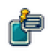

# Tap to Pin Tooltip

A configurable Balatro mod that makes card descriptions easier to inspect using touch controls.

**Creator:** GlowlineStd  
**Version:** 1.1.1  
**Requirement:** [Steamodded](https://github.com/Steamodded/smods)

## Features




- **Tap to pin:** Tap a Joker, consumable, or another eligible card to keep its tooltip visible.
- **Tap to dismiss:** Tap the same card, a different card, or an empty area to close the previous tooltip. Dismissed cards are deselected automatically.
- **Drag to dismiss:** Tooltips disappear as soon as a card is dragged a short distance, and stay hidden for that drag.
- **Clean release:** Dropping a dragged card without taking an action returns it to its unselected position.
- **Hand cards:** Playing cards in your hand retain their regular press-and-hold inspection behavior.
- **Tooltip scale:** Choose a size from **1.00× to 1.50×** in steps of **0.05×**.
- **Hide attached card buttons:** Optionally hide the action buttons attached directly to cards across shop cards, Jokers, consumables, vouchers, boosters, and other card types. Prices and card descriptions remain visible.

## Installation

1. Install Steamodded in your copy of Balatro.
2. Download the release ZIP and extract it.
3. Copy the **`TapToPinTooltip`** folder into your Balatro **`Mods`** directory.
4. Launch Balatro. Find **Tap to Pin Tooltip** in the Steamodded mod list.

The directory should look like this:

```text
Mods/
└── TapToPinTooltip/
    ├── tap-to-pin-tooltip.json
    ├── main.lua
    ├── config.lua
    ├── assets/
    │   ├── 1x/tap-to-pin-icon.png
    │   └── 2x/tap-to-pin-icon.png
    ├── localization/
    │   ├── default.lua
    │   ├── en-us.lua
    │   ├── es_ES.lua
    │   └── es_419.lua
    ├── README.md
    └── CHANGELOG.md
```

## Configuration

In Balatro, open **Mods → Tap to Pin Tooltip → Config**. The configuration panel contains the tooltip scale selector and the card-button visibility toggle.

**Languages:** The configuration automatically uses Spanish when Balatro is set to Spanish (Spain or Latin America) and English when set to English. Other game languages fall back to English. The Mods menu also shows a localized mod description.

| Setting | Default | Description |
| --- | --- | --- |
| Tooltip scale | 1.00× | Changes the size of tooltip text and panels (1.00×–1.50×, 0.05× increments). |
| Hide attached card buttons | Off | Hides individual action buttons displayed next to cards. |

**Important:** Hiding attached action buttons is optional and disabled by default so normal card actions remain accessible. Turn it on only if you already have a convenient way to perform those actions. This option hides UI controls; it does not replace buying, selling, or using cards with new gestures.

## Mod icon

The mod ships with a custom **34×34** icon for 1× scaling and a **68×68** icon for 2× scaling, displayed in the Steamodded Mods menu.

## Input behavior

Tap-to-pin functionality is enabled when Balatro reports touch input. Other input methods retain their usual hover and click behavior. Tooltip scaling and the button-visibility option remain configurable in the mod menu.

## Updating or uninstalling

- To update, close Balatro and replace the existing `TapToPinTooltip` folder with the new release folder.
- If upgrading from a pre-release build, revisit the settings after starting Balatro, as the public release uses a new mod identifier.
- To uninstall, close Balatro and delete the `TapToPinTooltip` folder.

## Reporting bugs

Include your Balatro version, Steamodded version, the action you performed, and the behavior you observed. If the issue is visual, include a screenshot if possible.

---

Created by **GlowlineStd**.
